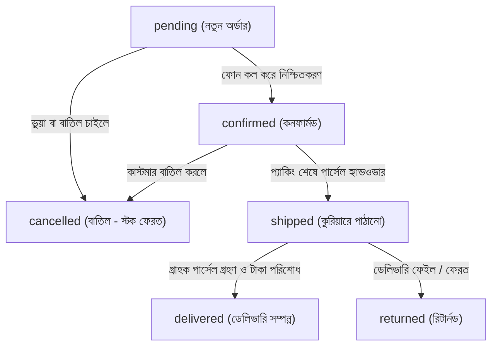

# ইকো আউটফিটস (Echo Outfits) — সম্পূর্ণ ওয়েবসাইট ও বিজনেস ম্যানেজমেন্ট হ্যান্ডবুক

এই গাইডটি **Echo Outfits**-এর মালিক এবং পরিচালকদের জন্য তৈরি করা হয়েছে, যাতে কোনো প্রোগ্রামিং জ্ঞান ছাড়াই আপনি নিজে আপনার সম্পূর্ণ ওয়েবসাইট, পণ্য, ইনভেন্টরি, অর্ডার এবং ডেলিভারি পরিচালনা করতে পারেন।

---

## সূচিপত্র (Table of Contents)
1. [প্রজেক্ট ওভারভিউ ও টেকনোলজি স্ট্যাক](#১-প্রজেক্ট-ওভারভিউ-ও-টেকনোলজি-স্ট্যাক)
2. [অ্যাডমিন প্যানেলে লগইন ও অ্যাক্সেস](#২-অ্যাডমিন-প্যানেলে-লগইন-ও-অ্যাক্সেস)
3. [ডাটাবেস ম্যানেজমেন্ট গাইড](#৩-ডাটাবেস-ম্যানেজমেন্ট-গাইড)
4. [প্রোডাক্ট ও ইনভেন্টরি ম্যানেজমেন্ট](#৪-প্রোডাক্ট-ও-ইনভেন্টরি-ম্যানেজমেন্ট)
5. [অর্ডার ম্যানেজমেন্ট ও স্ট্যাটাস লাইফসাইকেল](#৫-অর্ডার-ম্যানেজমেন্ট-ও-স্ট্যাটাস-লাইফসাইকেল)
6. [কুপন কোড ও ডিসকাউন্ট পলিসি](#৬-কুপন-কোড-ও-ডিসকাউন্ট-পলিসি)
7. [সিক্রেট টোকেন ও API কি গাইড](#৭-সিক্রেট-টোকেন-ও-api-কি-গাইড)
8. [পেমেন্ট গেটওয়ে ও ক্যাশ অন ডেলিভারি (COD)](#৮-পেমেন্ট-গেটওয়ে-ও-ক্যাশ-অন-ডেলিভারি-cod)
9. [কুরিয়ার ও পার্সেল শিপমেন্ট](#৯-কুরিয়ার-ও-পার্সেল-শিপমেন্ট)
10. [বিক্রি হিসাব, লাভ-লোকসান ও রিপোর্ট](#১০-বিক্রি-হিসাব-লাভ-লোকসান-ও-রিপোর্ট)
11. [ওয়েবসাইট কন্টেন্ট ও পলিসি পরিবর্তন](#১১-ওয়েবসাইট-কন্টেন্ট-ও-পলিসি-পরিবর্তন)
12. [কাস্টমার সাপোর্ট ও নোটিফিকেশন](#১২-কাস্টমার-সাপোর্ট-ও-নোটিফিকেশন)
13. [সাইটের নিরাপত্তা ও ব্যাকআপ গাইড](#১৩-সাইটের-নিরাপত্তা-ও-ব্যাকআপ-গাইড)
14. [ধাপে ধাপে ব্যবহারিক টিউটোরিয়াল](#১৪-ধাপে-ধাপে-ব্যবহারিক-টিউটোরিয়াল)

---

## ১. প্রজেক্ট ওভারভিউ ও টেকনোলজি স্ট্যাক

ইকো আউটফিটস সম্পূর্ণ আধুনিক **MERN (MongoDB, Express, React, Node.js)** আর্কিটেকচারে তৈরি:

- **Frontend (ওয়েবসাইট ইন্টারফেস)**: `client/` ফোল্ডারে React 19, TypeScript, Vite এবং TailwindCSS 4 দিয়ে নির্মিত। এটি অতি দ্রুত গতিতে লোড হয়।
- **Backend (সার্ভার ও এপিআই)**: `server/` ফোল্ডারে Node.js, Express এবং TypeScript দিয়ে তৈরি। এটি সমস্ত হিসাব, স্টক যাচাই এবং নিরাপত্তা নিশ্চিত করে।
- **Database (ডাটাবেস)**: **MongoDB** (Mongoose ODM এর মাধ্যমে যুক্ত)। সমস্ত প্রোডাক্ট, গ্রাহক, অর্ডার এবং সেটিংস এখানে সুরক্ষিত থাকে।
- **যোগাযোগ ব্যবস্থা**: ব্রাউজার থেকে React ফ্রন্টএন্ড Axios/Fetch এর মাধ্যমে ব্যাকএন্ডের `/api` এন্ডপয়েন্টে তথ্য পাঠায়। ব্যাকএন্ড যাচাই-বাছাই করে ডাটাবেসে সেভ করে।

### ফোল্ডার ম্যাপ (কোন ফাইল কেন প্রয়োজন):
```text
E-com-mern-1/
├── client/                      # ফ্রন্টএন্ড ওয়েবসাইট
│   ├── src/
│   │   ├── pages/               # বিভিন্ন পেজ (HomePage, ShopPage, CheckoutPage, AdminDashboardPage)
│   │   ├── components/          # রিইউজেবল উপাদান (ProductCard, Navbar, Footer, SizeGuideModal)
│   │   ├── data/sampleProducts.ts # ডেমো ক্যাটালগ (৬১টি বাস্তবসম্মত প্রোডাক্ট)
│   │   └── context/CartContext.tsx# কার্ট ও লোকাল স্টোরেজ স্টেট
├── server/                      # ব্যাকএন্ড সার্ভার
│   ├── src/
│   │   ├── models/              # ডাটাবেসের কাঠামো (Product, Order, User, Coupon, Payment, StoreSettings)
│   │   ├── controllers/         # বিজনেস লজিক (অর্ডার তৈরি, স্টক ম্যানেজমেন্ট)
│   │   ├── routes/              # এপিআই রুটস (/api/orders, /api/products, ইত্যাদি)
│   │   ├── integrations/        # পেমেন্ট (SSLCOMMERZ, aamarPay) ও কুরিয়ার (Pathao, Steadfast)
│   │   └── scripts/             # অ্যাডমিন তৈরি ও সিড স্ক্রিপ্ট (createAdmin.ts, seed.ts)
├── docs/                        # সমস্ত পরিচালনা গাইড ও ডকুমেন্টেশন
└── .env.example                 # সার্ভারের কনফিগারেশন টেমপ্লেট
```

---

## ২. অ্যাডমিন প্যানেলে লগইন ও অ্যাক্সেস

### অ্যাডমিন প্যানেলের ইউআরএল (URL):
- **লোকাল কম্পিউটারে**: `http://localhost:5173/admin/dashboard`
- **লাইভ ওয়েবসাইটে**: `https://yourdomain.com/admin/dashboard`

### অ্যাডমিন অ্যাকাউন্ট তৈরি (Initialization):
নিরাপত্তার স্বার্থে কোনো ডিফল্ট পাসওয়ার্ড রাখা হয়নি। প্রথম অ্যাডমিন তৈরি করতে সার্ভারের টার্মিনালে রান করুন:
```bash
cd server
npm run create-admin
```
টার্মিনাল আপনার কাছ থেকে **Email**, **Name**, এবং **Secure Password** (কমপক্ষে ৮ ডিজিট) চেয়ে সুরক্ষিতভাবে ডাটাবেসে `OWNER` রোল সহ অ্যাডমিন সংরক্ষণ করবে।

### রোল ও পারমিশন লেভেল:
1. `owner` (সর্বোচ্চ ক্ষমতা): সকল সেটিংস, কুপন, ক্যাশ রিপোর্ট, অ্যাডমিন পারমিশন।
2. `admin` (প্রধান ব্যবস্থাপক): অর্ডার, স্টক, প্রোডাক্ট পরিবর্তন।
3. `order_manager` (অর্ডার অপারেটর): অর্ডার দেখা, কনফার্ম করা, কুরিয়ারে পাঠানো।
4. `inventory_manager` (স্টক ম্যানেজার): প্রোডাক্টের সাইজ, স্টক ও দাম আপডেট করা।

---

## ৩. ডাটাবেস ম্যানেজমেন্ট গাইড

ডাটাবেস হিসেবে ব্যবহৃত হচ্ছে **MongoDB**।

### ডাটাবেসের মূল টেবিল (Collections):
| ডাটার ধরণ | মডেল নাম | গুরুত্বপূর্ণ ফিল্ডসমূহ | পরিচালনার উত্তম মাধ্যম |
| :--- | :--- | :--- | :--- |
| **পণ্য (Products)** | `Product` | `title`, `price`, `compareAtPrice`, `variants`, `category`, `isPublished` | অ্যাডমিন প্যানেল |
| **সাইজ ও স্টক** | `variants` (ইনসাইড Product) | `size` (S, M, L, XL, XXL), `color`, `sku`, `stock` | ইনভেন্টরি ট্যাব |
| **অর্ডার (Orders)** | `Order` | `orderNumber`, `items`, `shippingAddress`, `payableTotal`, `status`, `paymentMethod` | অর্ডার ম্যানেজমেন্ট ট্যাব |
| **কুপন (Coupons)** | `Coupon` | `code`, `discountType`, `discountValue`, `minOrderAmount`, `isActive` | অ্যাডমিন প্যানেল / API |
| **পেমেন্ট (Payments)** | `Payment` | `orderNumber`, `provider`, `amount`, `transactionId`, `status` | পেমেন্ট হিস্ট্রি |
| **গ্রাহক (Users)** | `User` | `name`, `email`, `phone`, `role`, `isActive` | ডাটাবেস / ব্যাকএন্ড |
| **শিপিং চার্জ** | `StoreSettings` | `deliveryDhaka`, `deliveryOutsideDhaka`, `freeDeliveryThreshold` | ড্যাশবোর্ড সেটিংস ট্যাব |

> [!TIP]
> কখনো ডাটাবেসে সরাসরি কোনো অর্ডারের দাম বা আইটেম এডিট করবেন না। সাধারণ কাজের জন্য সবসময় অ্যাডমিন ড্যাশবোর্ড ব্যবহার করুন।

---

## ৪. প্রোডাক্ট ও ইনভেন্টরি ম্যানেজমেন্ট

### নতুন প্রোডাক্টের উদাহরণ (প্রোডাক্ট যোগ করার নিয়ম):
- **পণ্যের নাম**: "Echo Phantom Jet Black Drop-Shoulder Tee"
- **মূল্য**: ৳৮৫০ (রেগুলার প্রাইস ৳১,১০০)
- **ক্যাটাগরি**: `drop-shoulder`
- **সাইজ ও স্টক**:
  - সাইজ M: স্টক ২০টি (SKU: `EO-DS-BLK-M`)
  - সাইজ L: স্টক ২৫টি (SKU: `EO-DS-BLK-L`)
  - সাইজ XL: স্টক ১৫টি (SKU: `EO-DS-BLK-XL`)
- **ছবি গাইড**:
  - প্রস্তাবিত ফরম্যাট: WebP অথবা JPG.
  - আদর্শ সাইজ: 1000 x 1250 পিক্সেল (৪:৫ রেশিও ফ্যাশন ফটোর জন্য সেরা)।
  - ফাইল সাইজ: প্রতিটি ছবি ২০০ KB-র নিচে রাখা উত্তম, যাতে সাইট দ্রুত লোড হয়।

---

## ৫. অর্ডার ম্যানেজমেন্ট ও স্ট্যাটাস লাইফসাইকেল

### অর্ডারের সম্পূর্ণ জীবনচক্র:


### স্ট্যাটাস নির্দেশিকা:
1. **pending (নতুন অর্ডার)**: গ্রাহক অর্ডার প্লেস করেছেন। আপনার কাজ: গ্রাহককে ফোন দিয়ে ঠিকানা নিশ্চিত করা।
2. **confirmed (নিশ্চিত)**: অর্ডারটি নিশ্চিত। ওয়্যারহাউস থেকে টি-শার্ট এনে পলি ও সিকিউরিটি ব্যাগে প্যাক করুন।
3. **shipped (কুরিয়ারে হ্যান্ডওভার)**: Pathao বা Steadfast রাইডারকে পার্সেল বুঝিয়ে দেওয়া হয়েছে। ট্র্যাকিং কোড জেনারেট হয়েছে।
4. **delivered (ডেলিভারি সম্পন্ন)**: গ্রাহক পণ্য পেয়েছেন এবং ক্যাশ অন ডেলিভারি (COD) টাকা কুরিয়ারকে পরিশোধ করেছেন।
5. **cancelled (বাতিল)**: গ্রাহক যদি অর্ডার বাতিল করেন, সিস্টেম স্বয়ংক্রিয়ভাবে বুকিং হওয়া স্টক পুনরায় মূল ইনভেন্টরিতে ফেরত পাঠায়।

---

## ৬. কুপন কোড ও ডিসকাউন্ট পলিসি

### কুপন কীভাবে কাজ করে:
- **শতকরা ডিসকাউন্ট (Percentage)**: যেমন `ECHO10` — ১০% ছাড় (সর্বোচ্চ সীমা নির্ধারণ করা যায়, যেমন সর্বোচ্চ ৳৩০০)।
- **নির্দিষ্ট ছাড় (Fixed Amount)**: যেমন `FLAT100` — সরাসরি ৳১০০ ছাড়।
- **হিসাবের নিয়ম**: ডিসকাউন্ট পণ্যের মূল্যের (Subtotal) উপর প্রযোজ্য হয়, ডেলিভারি চার্জের উপর নয়।
- **নিরাপত্তা**: গ্রাহক ব্রাউজারে কোড ম্যানিপুলেট করতে পারবে না; ব্যাকএন্ড সার্ভার প্রতিটি কুপনের মেয়াদ ও ন্যূনতম অর্ডার সীমা পুনরায় যাচাই করে হিসাব চূড়ান্ত করে।

---

## ৭. সিক্রেট টোকেন ও API কি গাইড

| টোকেনের নাম | এটি কী কাজে লাগে | কোথায় পাওয়া যায় | কোন ফাইলে বসাবেন |
| :--- | :--- | :--- | :--- |
| **JWT_SECRET** | অ্যাডমিন ও ইউজারের লগইন সেশন সুরক্ষায় | নিজের ইচ্ছামতো জটিল স্ট্রিং | `.env` ফাইলে |
| **MONGODB_URI** | ডাটাবেস সংযোগ স্ট্রিং | MongoDB Atlas ড্যাশবোর্ডে | `.env` ফাইলে |
| **SSLCOMMERZ_STORE_ID** | অনলাইন কার্ড/বিকাশ পেমেন্ট গ্রহণ | SSLCOMMERZ মার্চেন্ট প্যানেল | `.env` ফাইলে |
| **PATHAO_CLIENT_SECRET** | স্বয়ংক্রিয় পাঠাও পার্সেল তৈরি | Pathao Developer Console | `.env` ফাইলে |
| **STEADFAST_API_KEY** | স্টিডফাস্ট কুরিয়ার এপিআই | Steadfast Merchant Panel | `.env` ফাইলে |

> [!CAUTION]
> কোনো সিক্রেট কি (`.env` ফাইল) কখনো গিটহাবে পুশ করবেন না বা ফেসবুক/মেসেঞ্জারে কাউকে পাঠাবেন না।

---

## ৮. পেমেন্ট ও ডেলিভারি সেটিংস

- **ক্যাশ অন ডেলিভারি (COD)**: বর্তমানে ডিফল্ট পেমেন্ট মেথড হিসেবে চালু রয়েছে।
- **ডেলিভারি চার্জের বর্তমান মান**:
  - ঢাকা সিটির ভিতরে: **৳৭০**
  - ঢাকা সিটির বাইরে (সারা বাংলাদেশ): **৳১৩০**
  - ফ্রি ডেলিভারি সুবিধা: **৳২,০০০** বা তার বেশি কেনাকাটায় ডেলিভারি চার্জ সম্পূর্ণ ফ্রি (৳০)।
  - এই মানগুলো আপনি যেকোনো সময় অ্যাডমিন ড্যাশবোর্ডের "ডেলিভারি সেটিংস" ট্যাব থেকে পরিবর্তন করতে পারেন।

---

## ৯. বিক্রি ও মুনাফার সঠিক হিসাব (Finance Guide)

কখনোই মোট অর্ডার ভ্যালুকে লাভ বা ক্যাশ হিসেবে গণ্য করবেন না।

### আর্থিক পরিভাষাসমূহ:
1. **গ্রস সেলস (Gross Sales)**: মোট বিক্রি হওয়া অর্ডারের পরিমাণ।
2. **নেট রেভিনিউ (Net Revenue)**: গ্রস সেলস - ডিসকাউন্ট।
3. **পণ্য উৎপাদন/ক্রয় খরচ (COGS)**: টি-শার্ট তৈরি, ফেব্রিক ও প্রিন্টিং খরচ।
4. **প্রকৃত ক্যাশ (Actual Cash In Hand)**: শুধুমাত্র যে অর্ডারগুলো **delivered** হয়েছে এবং কুরিয়ার থেকে ব্যাংক/বিকাশে টাকা পেয়েছেন।

---

## ১০. জরুরি সমস্যা ও সমাধান (Troubleshooting)

- **অ্যাডমিন লগইন করতে পারছি না**:
  সার্ভার ফোল্ডারে গিয়ে `npm run create-admin` রান করে পাসওয়ার্ড রিসেট করে নিন।
- **সাইট লোড হচ্ছে না**:
  টার্মিনালে চেক করুন ক্লায়েন্ট ও সার্ভার চালু আছে কি না (`npm run dev`)।
- **ডাটাবেস ব্যাকআপ নেওয়ার নিয়ম**:
  MongoDB ক্লাউড (Atlas) ব্যবহার করলে স্বয়ংক্রিয় ব্যাকআপ সচল থাকে। লোকাল ব্যাকআপ নিতে টার্মিনালে রান করুন:
  ```bash
  mongodump --db echo-outfits --out ./backup
  ```
